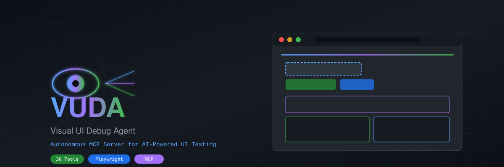
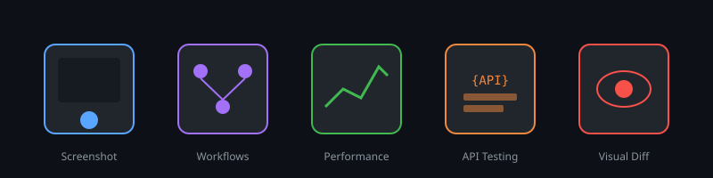
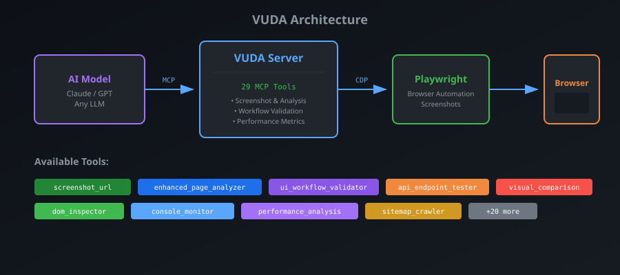

<p align="center">
  
</p>

<p align="center">
  <a href="https://www.npmjs.com/package/visual-ui-debug-agent-mcp"></a>
  <a href="https://www.npmjs.com/package/visual-ui-debug-agent-mcp"></a>
  <a href="https://github.com/samihalawa/visual-ui-debug-agent-mcp/stargazers"></a>
  <a href="https://github.com/samihalawa/visual-ui-debug-agent-mcp/blob/main/LICENSE"></a>
</p>

<p align="center">
  <b>Autonomous MCP Server for AI-Powered Visual UI Testing & Debugging</b><br>
  <sub>30 powerful tools for screenshots, workflows, performance, and visual analysis</sub>
</p>

---

## What is VUDA?

**VUDA (Visual UI Debug Agent)** is an MCP (Model Context Protocol) server that gives AI models the power to visually analyze, test, and debug web interfaces using Playwright. It enables any AI - even those without built-in vision - to inspect web pages, find UI bugs, test user workflows, and measure performance autonomously.

<p align="center">
  
</p>

### Key Capabilities

- **Visual Analysis** - Capture screenshots, analyze page structure, map interactive elements
- **Workflow Testing** - Automatically test user journeys with step-by-step validation
- **Performance Monitoring** - Measure load times, analyze metrics, identify bottlenecks
- **API Testing** - Validate backend endpoints and responses
- **Visual Comparison** - Detect UI changes between versions with diff highlighting
- **Console Monitoring** - Capture errors, warnings, and logs in real-time

---

## Quick Start

### Installation

```bash
# Install globally via npm
npm install -g visual-ui-debug-agent-mcp

# Or run directly with npx (no installation needed)
npx visual-ui-debug-agent-mcp
```

### Configure with Claude Desktop

Add to your Claude Desktop config (`~/Library/Application Support/Claude/claude_desktop_config.json`):

```json
{
  "mcpServers": {
    "vuda": {
      "command": "npx",
      "args": ["-y", "visual-ui-debug-agent-mcp"]
    }
  }
}
```

### Configure with Other MCP Clients

```json
{
  "mcpServers": {
    "vuda": {
      "command": "node",
      "args": ["/path/to/visual-ui-debug-agent-mcp/dist/index.js"]
    }
  }
}
```

---

## Architecture

<p align="center">
  
</p>

VUDA acts as a bridge between AI models and web browsers through the MCP protocol. It uses Playwright for reliable cross-browser automation and provides structured data that any AI can understand.

---

## Complete Tool Reference (30 Tools)

### Visual Analysis Tools

| Tool | Description |
|------|-------------|
| `enhanced_page_analyzer` | Comprehensive page analysis with element mapping, performance metrics, and console logs |
| `screenshot_url` | Capture high-quality screenshots of any URL with device emulation |
| `batch_screenshot_urls` | Screenshot multiple URLs in a single operation |
| `screenshot_local_files` | Capture screenshots of local HTML files |
| `visual_comparison` | Compare two pages/states and highlight visual differences |
| `dom_inspector` | Inspect DOM elements with computed styles and properties |

### Workflow & Testing Tools

| Tool | Description |
|------|-------------|
| `ui_workflow_validator` | Test complete user journeys with step-by-step validation |
| `navigation_flow_validator` | Validate multi-step navigation sequences |
| `api_endpoint_tester` | Test API endpoints with authentication support |

### Performance & Monitoring Tools

| Tool | Description |
|------|-------------|
| `performance_analysis` | Measure page load performance and Core Web Vitals |
| `console_monitor` | Monitor and capture console logs, errors, and warnings |
| `sitemap_crawler` | Crawl sitemaps and analyze page structure |

### Playwright Direct Controls

| Tool | Description |
|------|-------------|
| `playwright_navigate` | Navigate to URLs |
| `playwright_click` | Click on elements |
| `playwright_iframe_click` | Click elements inside iframes |
| `playwright_fill` | Fill form fields |
| `playwright_select` | Select dropdown options |
| `playwright_hover` | Hover over elements |
| `playwright_evaluate` | Execute JavaScript in page context |
| `playwright_console_logs` | Get console output |
| `playwright_get_visible_text` | Extract visible text content |
| `playwright_get_visible_html` | Get rendered HTML |
| `playwright_go_back` | Navigate back |
| `playwright_go_forward` | Navigate forward |
| `playwright_press_key` | Press keyboard keys |
| `playwright_drag` | Drag and drop elements |
| `playwright_screenshot` | Take custom screenshots |

### Utility Tools

| Tool | Description |
|------|-------------|
| `tunnel_helper` | Guide and manage Cloudflare tunnel setup for remote debugging |
| `debug_memory` | Save and retrieve debugging context across sessions |

---

## Usage Examples

### Take a Screenshot

```
Ask Claude: "Take a screenshot of https://example.com"
```

The AI will use `screenshot_url` to capture the page and return the image.

### Analyze a Page

```
Ask Claude: "Analyze the UI of https://myapp.com/dashboard and find any issues"
```

VUDA will use `enhanced_page_analyzer` to map all elements, check console for errors, and report findings.

### Test a Login Flow

```
Ask Claude: "Test the login flow on https://myapp.com - use test@example.com and password123"
```

The AI will use `ui_workflow_validator` to:
1. Navigate to the login page
2. Fill in credentials
3. Click submit
4. Verify successful login
5. Capture screenshots at each step

### Compare Two Versions

```
Ask Claude: "Compare the homepage before and after our CSS update"
```

Using `visual_comparison`, VUDA will highlight all visual differences between the two states.

### Monitor Performance

```
Ask Claude: "Check the performance of our checkout page"
```

`performance_analysis` will measure load times, analyze Core Web Vitals, and identify bottlenecks.

---

## Advanced Configuration

### Environment Variables

```bash
# Set browser options
PLAYWRIGHT_HEADLESS=true
PLAYWRIGHT_SLOW_MO=100

# Debug mode
DEBUG=vuda:*
```

### Programmatic Usage

```typescript
import { Server } from "@modelcontextprotocol/sdk/server/index.js";

// VUDA exposes all tools through the MCP protocol
const result = await client.callTool("enhanced_page_analyzer", {
  url: "https://example.com",
  includeConsole: true,
  mapElements: true,
  fullPage: true
});
```

---

## Why VUDA?

| Feature | VUDA | Other Solutions |
|---------|------|-----------------|
| **MCP Native** | Built for AI integration | Often REST-only |
| **30 Specialized Tools** | Comprehensive coverage | Limited toolsets |
| **Vision for Any AI** | Works without built-in vision | Requires vision models |
| **Autonomous Testing** | AI-driven workflows | Manual scripting |
| **Cross-Browser** | Playwright-powered | Single browser |
| **Zero Config** | Works out of the box | Complex setup |

---

## Requirements

- **Node.js** 18 or higher
- **npm** or **npx**
- Works on macOS, Linux, and Windows

---

## Contributing

Contributions are welcome! Please feel free to submit a Pull Request.

1. Fork the repository
2. Create your feature branch (`git checkout -b feature/amazing-feature`)
3. Commit your changes (`git commit -m 'Add amazing feature'`)
4. Push to the branch (`git push origin feature/amazing-feature`)
5. Open a Pull Request

---

## License

This project is licensed under the [ISC License](LICENSE).

---

<p align="center">
  <sub>Built with Playwright and the Model Context Protocol</sub><br>
  <sub>Made by <a href="https://github.com/samihalawa">@samihalawa</a></sub>
</p>
